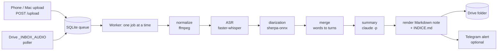

# transcription-stack-template

Self-hosted, always-on meeting transcription for one user or a small team, with zero per-minute
cost. Audio arrives through an HTTP upload endpoint (tailnet only) or a watched Drive inbox
folder, is queued in SQLite, transcribed with faster-whisper, split by speaker with sherpa-onnx,
merged into speaker turns, summarized by the `claude -p` CLI, and delivered as a Markdown note
(plus per-client indices) into a Drive folder, with an optional Telegram alert. Everything runs
CPU-only on a modest VPS, one job at a time.

> This is a sanitized template. All client names, hosts and IPs are placeholders
> (`Organización Ejemplo`, `<TAILSCALE_IP>`). Copy `config.example.toml` to `config.toml` and edit.
> The documentation in `docs/` is mostly in Spanish.

Python package name is `transcription247`.

## Architecture



```
received -> normalized -> transcribed -> diarized -> merged -> summarized -> delivered
             ffmpeg       whisper        sherpa      merge.py   claude -p    render.py
```

## Design principles

- **Queue + state machine.** `jobs.state` is the last completed stage; each stage writes a JSON
  artifact, so a crash, OOM kill or restart resumes from the last artifact on disk.
- **Idempotent jobs.** Jobs are keyed by the audio hash; re-uploads are discarded, re-runs
  rewrite a note only while it is still byte-for-byte what the worker wrote (hand edits are
  never overwritten).
- **No silent failures.** Every failure path increments a counter, is logged, and can raise a
  Telegram alert. A failed summary never blocks delivery (the note ships marked as pending).
- **The LLM only summarizes.** Identity, routing, client classification thresholds, file paths,
  retries, deletion and delivery are all decided by code; the model reads the transcript and
  drafts the summary.
- **Code decides everything else.** Every filesystem write passes `paths.guard_write()`; the API
  refuses wildcard binds and requires a bearer token.

## Hardware and benchmark summary

Figures from `bench/RESULTS.md` (8 vCPU AMD EPYC, 16 GB RAM, Debian 13, CPU only, capped to
4 vCPU / 3 GB per stage). No audio is shipped in this repository.

| Stage | Setting | Result |
|---|---|---|
| ASR | faster-whisper large-v3-turbo, int8, beam 5, 4 threads | RTF 0.27 (5 min clip), peak RSS about 1.66 GB |
| Diarization | sherpa-onnx pyannote-3.0 segmentation + embeddings | RTF about 0.09 to 0.14, peak RSS 0.2 to 1.1 GB |
| Whole pipeline, windowed | 20 / 60 / 120 min recordings | peak RSS 1857 / 1903 / 1909 MB (flat in duration), about 20 min of processing per hour of audio |

Both heavy stages process audio in windows of at most 15 minutes, so memory does not grow with
the length of the recording.

## Quick start

```bash
git clone <your-fork-url> transcription-stack-template && cd transcription-stack-template
uv sync                                  # dependencies
cp config.example.toml config.toml       # then edit: api.host, archivo.raiz, inbox.ruta, clients
uv run pytest -q                         # 161 tests, no models or network needed
# Download models into models/ (see "Install notes" below), then:
# edit the two paths in ops/t247-*.service to where you cloned the repo, then
ops/install.sh                           # secrets dir + API token + Drive folders + systemd --user units
uv run t247 doctor                       # environment checks
```

`config.toml` is gitignored and is the file the code loads (`--config` overrides the path).

## Test suite

161 tests in 13 files (`tests/`): state machine and thread safety of the store, path guard,
ASR/diarization windowing and speaker linking, merge, golden-file rendering of notes, indices,
inbox poller, upload API and an end-to-end worker integration test. No models, audio or network
are needed; the LLM and Telegram calls are faked.

## Folder map

```
src/transcription247/   21 modules: config, paths, ids, store, models, audio, asr, diarize,
                        windows, merge, summarize, prompts, render, indices, api, web, inbox,
                        notify, worker, doctor, cli
ops/                    install.sh, uninstall.sh, t247-worker.service, t247-api.service
docs/                   ARCHITECTURE.md (the contract), CLIENTES_IPHONE_MAC.md (client recipes)
bench/                  benchmark scripts, RESULTS.md, small result JSONs (no audio)
tests/                  pytest suite + golden notes
config.example.toml     copy to config.toml
```

## Install notes

`ops/install.sh` is idempotent and **never prints the API token**; read it with
`cat ~/.config/transcription247/api_token` when you need it on a phone.

Notifications are optional: put `{"token": "...", "chat_id": "..."}` into
`~/.config/transcription247/telegram.json` (mode `600`). Without it the worker uses a no-op
notifier.

Models are **not** in the repo (`models/` is gitignored): `faster-whisper-large-v3-turbo` under
`models/faster-whisper-large-v3-turbo/` and the sherpa-onnx segmentation + embedding models under
`models/sherpa-onnx-diarization/` (paths in `config.example.toml`). `t247 doctor` tells you
exactly which file is missing. Edit `WorkingDirectory=` / `ExecStart=` in `ops/*.service` to your
clone path before running `ops/install.sh`.

## License

MIT, see `LICENSE`.

## Author

Mario Chasco · Flowara AI

## Daily use

| | |
|---|---|
| Drop a recording | copy it into Drive `…/Transcripciones_24_7/_INBOX_AUDIO/` |
| From the phone | the *Transcribir* Shortcut → `POST /upload`, or the web page |
| Web page / status | `http://<TAILSCALE_IP>:8247/` (tailnet only) |
| Queue | `uv run t247 status` |
| Logs | `journalctl --user -u t247-worker -f` |
| Services | `systemctl --user status t247-worker t247-api` |

Add ` [2p]` (or `(2p)`) to a filename when you know how many people are speaking — a known speaker
count is always more reliable than automatic clustering.

## CLI

```
t247 worker                       run the daemon (this is what the unit runs)
t247 serve                        run the upload API (tailnet only)
t247 enqueue FILE [--title T] [--client K] [--language es|en] [--recorded-at ISO] [--speakers N]
t247 status                       queue counts + recent jobs
t247 retry JOB_ID                 rewind a failed job to its last good artifact and requeue
t247 resummarize JOB_ID           re-run the summary of a summary_pending job, rewrite the note
t247 reindex                      rebuild INDICE.md / catalog from a filesystem scan
t247 doctor                       environment checks (mount, models, claude, tailnet, units…)
```

## How a job recovers

`jobs.state` is the **last completed stage** and every stage writes a JSON artifact into
`data/jobs/<id>/`. A crash, an OOM kill or a `systemctl restart` therefore costs at most the stage
in flight: on startup stale leases are requeued and the pipeline resumes from the last artifact on
disk. Three failed attempts (backoff 60 s / 5 min / 30 min) mark a job `failed`; `t247 retry` puts
it back.

A **summary** failure never blocks delivery: the note ships with a `⚠️ Resumen pendiente` marker,
the job lands in `summary_pending`, and the worker retries the summary periodically — overwriting
the note in place only while it is still byte-for-byte the one it wrote. Edit a note by hand and it
is yours: the worker stops touching it and `t247 resummarize` writes a ` (2)` sibling instead.

## Development

```bash
uv run pytest -q           # 161 tests, no models, no network, ~3 s
uv run t247 --help
```

Tests never touch a real Drive: `tests/conftest.py` snapshots and restores `paths`' three roots
around every test, and `make_config(tmp_path)` builds a whole `Config` under `tmp_path`.

**Never write outside the owned tree.** Every filesystem write in the project goes through
`paths.guard_write()`, which accepts only `archivo.raiz`, `inbox.ruta` and `data/`, and hard-denies
any path containing the segment `_Protected_Archive` (a sibling archive owned by another system) or
`_Protected_Private`. That is enforced in code and covered by tests, not by convention.

If you run this on a shared box: anything long or heavy runs under
`systemd-run --user --collect -p MemoryMax=3G -p CPUQuota=400% -p Nice=19 …`, never straight in the
editor's process tree. See `CLAUDE.md`.

## Compatibilidad con el formato Fireflies (Spanish; optional reading)

Las notas se generan para leerse junto al archivo Fireflies existente, con el mismo esquema de
front-matter (una clave JSON por línea), los mismos nombres y orden de encabezados, el mismo
formato `**Speaker N** · [MM:SS]` por turno y los mismos formatos de fecha. Las diferencias son
intencionadas — quien escriba un parser para ambos archivos debe tenerlas en cuenta:

- **Timestamps `[MM:SS]` planos, sin enlace.** El archivo Fireflies los enlaza a su reproductor
  web; aquí no existe ese reproductor, así que `[MM:SS]` no es un enlace.
- **`origen_id` en vez de `fireflies_id`.** Mismo propósito (identificador único de la reunión),
  otro origen: un ULID de 26 caracteres generado localmente, no un id de Fireflies.
- **Sin `participantes_email`.** No hay direcciones de correo que registrar.
- **Clave `idioma` nueva.** No existe en el archivo Fireflies.
- **`enlace` siempre `null`.** Se conserva la clave por compatibilidad con el esquema, pero nunca
  apunta a nada.
- **Arrays JSON con espacio tras la coma** (`["a", "b"]`, no `["a","b"]`).
- **`generador: "transcription-24-7"`** en vez del valor que usaba Fireflies.

Todo lo demás — nombres y orden de encabezados, el formato de turno `**Speaker N** · [MM:SS]`, los
formatos de fecha, y una clave JSON por línea en el front-matter — coincide con el archivo
Fireflies existente.

## Uninstall

```bash
ops/uninstall.sh     # stops, disables and removes the two units — and nothing else
```

Data (`data/`), secrets and every note in Drive are left untouched.
